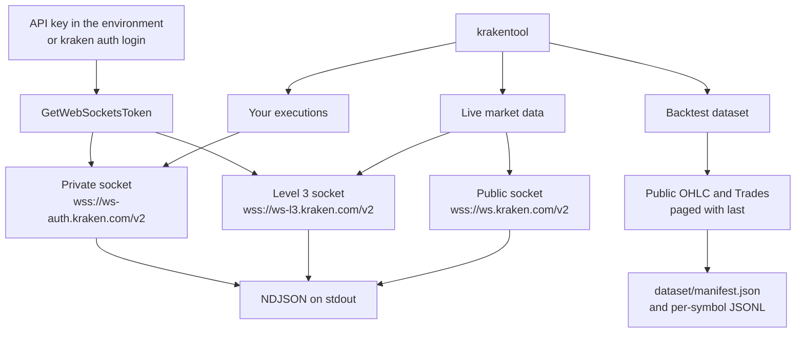
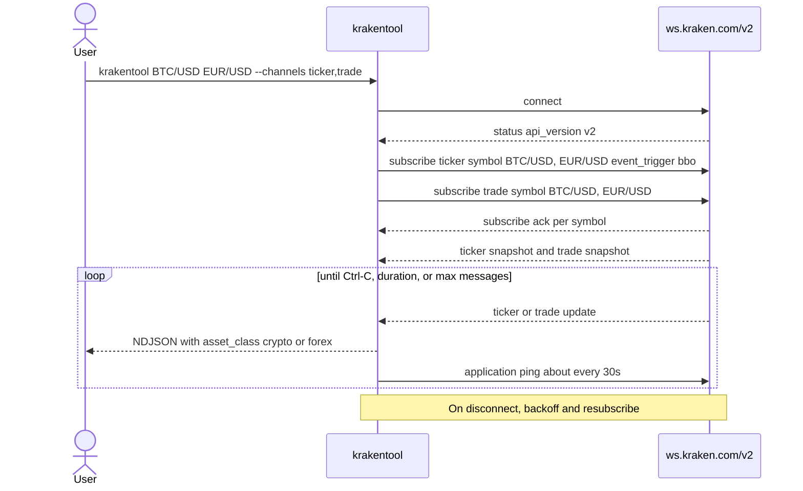
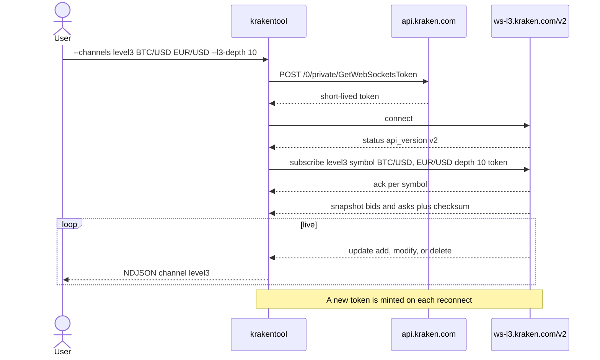
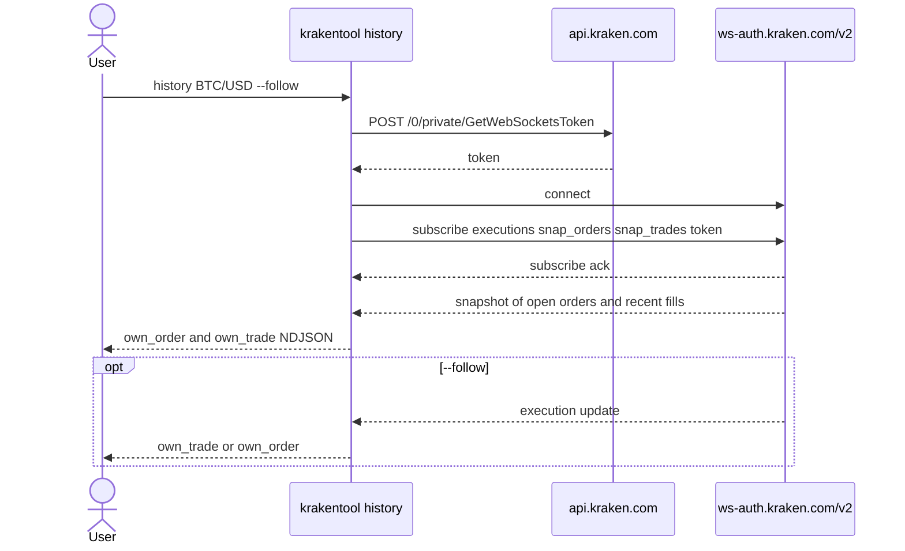
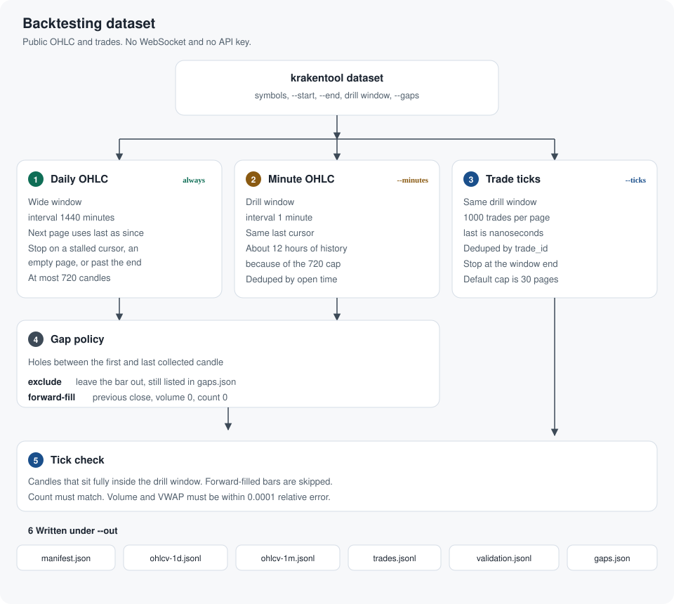
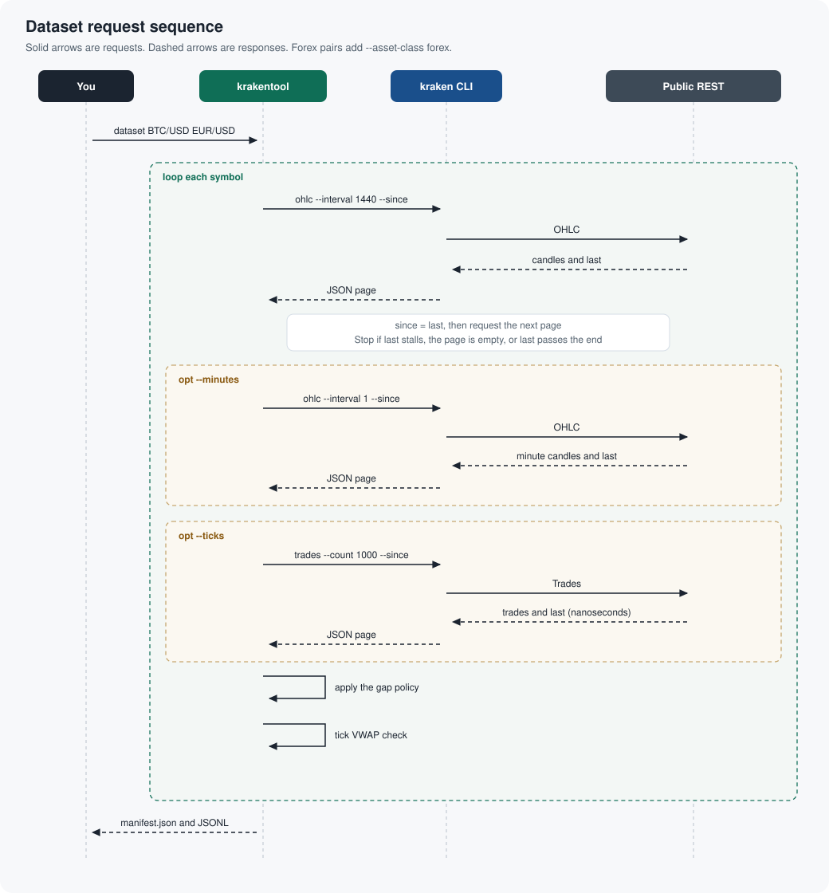

# krakentool

## Introduction

[Kraken Spot](https://docs.kraken.com/exchange/api-reference/spot-websocket) is a public market plus an account API, so the same venue can feed a monitor, a research notebook, or a trading application. Public channels publish ticker, trades, the aggregated book, and candles for crypto and forex on one symbol format (`BTC/USD`, `EUR/USD`). Private channels and order entry use an API key. WebSocket API v2 is the current interface: normalised JSON, `BTC/USD` symbols, and both market data and order messages on a persistent connection.

krakentool is a baseline on that API. It follows the live book, records your own fills and open orders, and builds a checked historical dataset you can replay before a strategy sends an order. A trading application keeps this layer and adds order entry from the same v2 catalog (`add_order`, `amend_order`, `cancel_order`), documented in the [Spot WebSocket reference](https://docs.kraken.com/exchange/api-reference/spot-websocket).

| Layer | What it gives a trading app | In this project |
| --- | --- | --- |
| Public market data | Quotes, prints, level 2 book, candles | `krakentool` on `wss://ws.kraken.com/v2` |
| Your account | Open orders and recent fills, then live updates | `krakentool history` on `wss://ws-auth.kraken.com/v2` |
| Level 3 book | Each resting order, for queue and microstructure work | `--channels level3` on `wss://ws-l3.kraken.com/v2` |
| History | Daily and minute bars, trade ticks, a VWAP check | `krakentool dataset` |
| Order entry | Place, amend, and cancel | [Spot WebSocket v2 order methods](https://docs.kraken.com/exchange/api-reference/spot-websocket) |

### API key and secret

Public market data needs no key. Level 3, your executions, and any later order call need a key pair from Kraken Pro.

1. Sign in to Kraken Pro, open the profile menu, and choose **Settings**, then **API**.
2. Choose **Create API key**. The description is the key’s name. Give it a name you will recognise, such as `krakentool`.
3. Turn on **Access WebSockets API** (also shown as the WebSocket interface). That permission is what allows [`GetWebSocketsToken`](https://docs.kraken.com/api-reference/trading/get-websockets-token). Level 3 and `history` both use that token.
4. For a read-only baseline, also turn on **Query Open Orders & Trades**. Leave **Withdraw Funds** off. Turn on **Modify Orders** and **Cancel/Close Orders** when the application places and cancels orders. The full matrix is in [API key permissions](https://docs.kraken.com/exchange/guides/rest/api-keys).
5. Restrict the key to the IP addresses of the machine that will call the API, then choose **Generate key**.

Kraken shows two values. The public key is the API key. The private key is the API secret. The secret is shown once; store both in a password manager. The secret is used only to sign requests. It is never sent on the wire. Signing is HMAC-SHA512 over the nonce, the body, and the path, described in [Spot REST authentication](https://docs.kraken.com/exchange/guides/rest/authentication).

Pass the pair in the environment, or store it with the Kraken CLI (`kraken auth login`). This repository does not contain keys.

```bash
export KRAKEN_API_KEY="the public key"
export KRAKEN_API_SECRET="the private key"
```

krakentool calls `GetWebSocketsToken`, then puts that token in the subscribe message. See [Spot WebSocket authentication](https://docs.kraken.com/exchange/guides/websockets/authentication).

### Kraken documentation

| Topic | Link |
| --- | --- |
| Create an API key | [How to create an API key on Kraken Pro](https://support.kraken.com/articles/how-to-create-an-api-key-on-kraken-pro) |
| Key permissions | [API key permissions](https://docs.kraken.com/exchange/guides/rest/api-keys) |
| REST signing, nonce, `API-Key` and `API-Sign` | [Spot REST authentication](https://docs.kraken.com/exchange/guides/rest/authentication) |
| WebSocket token | [GetWebSocketsToken](https://docs.kraken.com/api-reference/trading/get-websockets-token) and [WebSocket authentication](https://docs.kraken.com/exchange/guides/websockets/authentication) |
| Spot WebSocket v2, including order entry | [Spot WebSocket](https://docs.kraken.com/exchange/api-reference/spot-websocket) |
| Level 3 order book | [level3 channel](https://docs.kraken.com/exchange/api-reference/spot-websocket-v2/level3) and [Level 3 market data](https://docs.kraken.com/exchange/guides/general/l3-data) |
| Candles | [OHLC channel](https://docs.kraken.com/exchange/api-reference/spot-websocket-v2/ohlc) |

## Get started

You need Python 3.11 or newer and [uv](https://docs.astral.sh/uv/getting-started/installation/). Runtime dependencies are declared in `pyproject.toml` and pinned in [`uv.lock`](../uv.lock). That lockfile is the install list: today it is this package plus `websockets` 15.0.1. `uv sync` creates `.venv` from the lockfile and installs the `krakentool` command into it.

```bash
uv sync
uv run krakentool --help
uv run krakentool BTC/USD EUR/USD --channels ticker,trade --duration 10
```

Public ticker, trades, book, and OHLC need no API key. Level 3 and `history` mint a WebSocket token from `KRAKEN_API_KEY` and `KRAKEN_API_SECRET`, or from the key stored by `kraken auth login`. The `dataset` command shells out to the `kraken` CLI, which is a separate install and must be on `PATH`. The program is licensed under GPL-3.0-or-later; see [License](#license).

More commands are in [Sample commands](#sample-commands).

## Features

| Command | What you get | Transport |
| --- | --- | --- |
| `krakentool` | Live ticker, trades, aggregated book, and OHLC | `wss://ws.kraken.com/v2` |
| `krakentool --channels level3` | Per-order book (add, modify, delete) | `wss://ws-l3.kraken.com/v2` |
| `krakentool history` | Your open orders and latest fills, then live updates with `--follow` | `wss://ws-auth.kraken.com/v2` |
| `krakentool dataset` | Daily OHLC, optional minute bars and trade ticks, VWAP check, gap policy | Public REST, paged on `last` |

A pair is `forex` when both legs are fiat (`EUR/USD`, `USD/JPY`). Anything else, including `BTC/USD` and `USDT/USD`, is `crypto`. Every market event carries that tag.

## How a run is shaped



Public channels (`ticker`, `trade`, `book`, `ohlc`) share one socket. Level 3 cannot share it, so asking for both opens a second connection. Stdout is one JSON object per line. Connection status stays on stderr.

## Live public market data

Default symbols are `BTC/USD`, `ETH/USD`, `SOL/USD`, `EUR/USD`, `GBP/USD`, and `USD/JPY`. The ticker trigger defaults to `bbo`, so a quote updates when the best bid or offer changes, which matters on quieter forex books.



`book` is the aggregated level 2 book (depth 10, 25, 100, 500, or 1000). `ohlc` is the candle stream. Heartbeats and subscribe acknowledgements are not written to stdout.

## Level 3 order book

Level 3 shows each resting order: `order_id`, `limit_price`, and `order_qty`. A snapshot is followed by `add`, `modify`, and `delete`. Depth is 10, 100, or 1000 price levels per side. At most 200 symbols fit on one connection.



The token is sent only inside the subscribe message. It is not logged.

## Your fills and orders

`history` subscribes to the private `executions` channel. The snapshot is open orders plus the latest 50 fills. Older closed orders are not replayed. `--follow` keeps the socket open for new fills and order updates. Without it, the process prints the snapshot and exits once the burst goes quiet.



A fill (`exec_type` `trade`) becomes `own_trade` with price, size, fee, and whether it was maker. Other execution reports become `own_order`. REST pair names such as `XXBTZUSD` are rewritten to v2 symbols such as `BTC/USD` when they appear.

## Backtesting dataset

`krakentool dataset` builds an offline series for a backtest. It reads public OHLC and public trades through the `kraken` CLI. It does not open a WebSocket, and it does not use an API key.

Daily candles cover the long window. Minute candles and trade ticks are optional and share a shorter drill window. Kraken returns at most 720 OHLC points for one interval, so a minute series only reaches about the last 12 hours. Keep the drill window inside that.

### Flow



One symbol is collected at a time.

1. **Daily OHLC** always runs. The first request sets `--since` to the window start. Each response includes `last`, and the next request passes that value as `--since`. Paging stops when the cursor stalls, the page is empty, or `last` is at or past the end. Candles are kept by open time. A run that hits the page cap is marked truncated in the manifest.
2. **Minute OHLC** runs with `--minutes`, on the drill window, at interval `1`, with the same cursor.
3. **Trade ticks** run with `--ticks`. Each page holds 1000 trades. The trade cursor is in nanoseconds. Rows are kept by `trade_id`. Paging stops once a trade time reaches the drill end, or at 30 pages.
4. **Gap policy** looks for holes between the first and last candle that came back. `--gaps exclude` leaves those bars out and still records the missing open times in `gaps.json`. `--gaps forward-fill` inserts a flat bar at the previous close, with volume 0, count 0, and `gap` set.
5. **Tick check** compares ticks with candles that sit fully inside the drill window. The trade count must match. Volume and VWAP must fall within `--vwap-tolerance` (default `0.0001`) relative error. Forward-filled bars are skipped. A miss means a page was skipped or the candle is incomplete.
6. **Files** land under `--out`: `manifest.json`, plus one directory per symbol (`BTC-USD`, `EUR-USD`).

A forex symbol, both legs fiat, adds `--asset-class forex` on every `kraken` call. `BTC/USD` does not.

### Sequence



`krakentool` runs `kraken -o json --log-format compact` and reads one JSON object from stdout. The CLI calls public OHLC or Trades. A pause, 0.25 seconds by default, sits between pages. Daily paging is shown in full. Minute candles and trade ticks use that same `last` loop when those flags are set. After the pages, the process dedupes, applies the gap policy, checks tick VWAP against the candles, and prints the path to `manifest.json`.

### Files

| File | Contents |
| --- | --- |
| `manifest.json` | Candle counts, gap counts, truncated flags, VWAP failures |
| `<symbol>/ohlcv-1d.jsonl` | Daily open, high, low, close, VWAP, volume, trade count |
| `<symbol>/ohlcv-1m.jsonl` | Minute candles, when `--minutes` is set |
| `<symbol>/trades.jsonl` | Price, size, side, trade id |
| `<symbol>/validation.jsonl` | Candle VWAP against tick VWAP, with `ok` |
| `<symbol>/gaps.json` | Missing daily and minute open times |

## Sample commands

These assume [Get started](#get-started) has been run, so `uv run` uses the environment from `uv.lock`. Market events go to stdout. Connection status stays on stderr. `Ctrl-C` stops a live stream.

### Public market data

Crypto and forex share one socket. The default set is `BTC/USD`, `ETH/USD`, `SOL/USD`, `EUR/USD`, `GBP/USD`, and `USD/JPY`, on the `ticker` channel, with quotes published when the best bid or offer changes.

```bash
uv run krakentool
```

Ticker and trades for one crypto book and one forex book, printed as text for ten seconds:

```bash
uv run krakentool BTC/USD EUR/USD \
  --channels ticker,trade \
  --format text \
  --duration 10
```

Publish the ticker on prints instead of quote changes, and stop after 20 events:

```bash
uv run krakentool EUR/USD USD/JPY \
  --channels ticker \
  --event-trigger trades \
  --max-messages 20
```

Aggregated level 2 book, 25 levels per side, and one-minute candles. Heartbeats are not written to stdout. `--strict` exits if a symbol subscription is rejected. `--no-snapshot` waits for live updates.

```bash
uv run krakentool BTC/USD GBP/USD \
  --channels book,ohlc \
  --book-depth 25 \
  --ohlc-interval 1 \
  --strict \
  --duration 15
```

```bash
uv run krakentool SOL/USD --channels trade --no-snapshot --duration 10
```

### Level 3 order book

Level 3 is the per-order book. Depth is 10, 100, or 1000. It needs the same API key as `history`. The token is not printed.

```bash
uv run krakentool BTC/USD EUR/USD \
  --channels level3 \
  --l3-depth 10 \
  --format text \
  --duration 10
```

Public channels and level 3 cannot share a socket, so this opens both connections:

```bash
uv run krakentool BTC/USD EUR/USD \
  --channels ticker,level3 \
  --l3-depth 10 \
  --duration 10
```

### Your fills and orders

The snapshot is open orders plus the latest 50 fills. Older closed orders are not replayed. Credentials come from `KRAKEN_API_KEY` / `KRAKEN_API_SECRET` or from `kraken auth login`.

```bash
uv run krakentool history
uv run krakentool history --format text
```

Fills only, orders only, or the live feed after the snapshot. A symbol filter accepts v2 names (`BTC/USD`) and REST names (`XXBTZUSD`). `--no-open` skips the open-order snapshot.

```bash
uv run krakentool history BTC/USD --trades
uv run krakentool history --orders --no-open
uv run krakentool history --follow --duration 30
```

### Backtesting dataset

Daily candles for the long window. Minute candles and trade ticks share the drill window and have to sit inside the last 12 hours or so, because OHLC returns at most 720 bars. `dataset/` is gitignored.

Daily bars only, for crypto and forex:

```bash
uv run krakentool dataset BTC/USD EUR/USD \
  --start 2026-10-30 --end 2026-11-01 \
  --gaps exclude \
  --out dataset
```

Minute bars, trade ticks, and the VWAP check. Missing candles stay out of the series and are listed in `gaps.json`:

```bash
uv run krakentool dataset BTC/USD EUR/USD \
  --start 2026-10-30 --end 2026-11-01 \
  --drill-start 2026-11-01T01:56:00Z \
  --drill-end 2026-11-01T02:11:00Z \
  --minutes --ticks \
  --gaps exclude \
  --vwap-tolerance 0.0001 \
  --pause 0.25 \
  --max-trade-pages 30 \
  --out dataset
```

The same drill, with a hole filled by the previous close at zero volume:

```bash
uv run krakentool dataset BTC/USD \
  --start 2026-10-30 --end 2026-11-01 \
  --drill-start 2026-11-01T01:56:00Z \
  --drill-end 2026-11-01T02:11:00Z \
  --minutes --ticks \
  --gaps forward-fill \
  --out dataset
```

## License

Copyright (C) 2026 aifintech-do. krakentool is free software under the GNU General Public License, version 3 or any later version, as published by the Free Software Foundation. The full text is [LICENSE](../LICENSE). There is no warranty. `krakentool --version` prints the short notice. Each source file carries the same copyright and license header.
